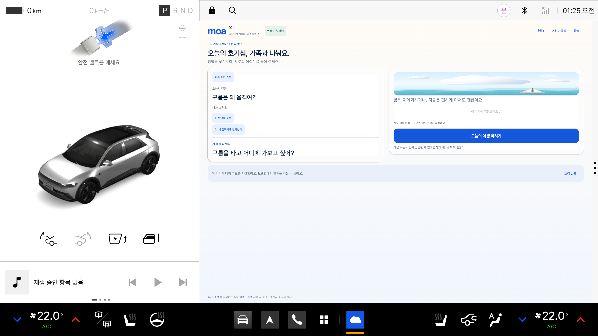

# 모아 · MOA

**아이의 질문을 짧은 설명과 선택형 이야기로 풀고, 가족의 대화로 이어 주는 차량용 질문 여행.**

휴게·충전 중 보호자와 함께 사용하는 Kotlin/Jetpack Compose MVP입니다. 질문 카드부터 이야기의 끝, 가족 대화 카드 보관까지 기기 안에서 동작합니다.

[제출용 release APK](apk/이승민_모아_release.apk) · [시연 안내](docs/DEMO.md) · [콘텐츠 검토](docs/CONTENT_REVIEW.md)



[질문 화면](docs/screenshots/01-questions.png) · [사실 설명](docs/screenshots/02-fact.png) · [상상 이야기](docs/screenshots/03-story.png) · [중단 화면](docs/screenshots/07-driving-pause.png)

## 구현한 기능

| 흐름 | 현재 동작 |
| --- | --- |
| 질문 꺼내기 | 질문 카드 10개, 검색, 직접 입력, 지원 기기의 오프라인 음성 입력 |
| 사실 설명 | 고정 설명과 허용된 질문 문장 매칭. 모호한 질문은 최대 2회 확인 후 가족에게 전달 |
| 상상 이야기 | 사실과 창작을 명시적으로 구분. 소재 10개 × 선택 경로 4개, 최대 두 번의 선택 |
| 공간 경험 | 바다·숲·별빛 화면 테마, 직접 누를 때만 재생하는 짧은 소리와 음성 읽기 |
| 가족 대화 | 오늘의 질문, 실제 선택, 열린 질문 하나. 추정·평가·채점 없음 |
| 보관함 | 보호자가 누른 카드만 저장. 최근 100개, 개별 조회·삭제·전체 삭제 |
| 보호자 제어 | 시작·중단·재개·종료, 제한 상태·연결 손실·앱 이탈 시 중단, 자동 재개 없음 |

구름·비·무지개·산·강·바다·나무·바람·달·별을 다룹니다. 카드 밖 질문에 사실 답변을 생성하지 않습니다.

## 제출 파일

- 참가 형태·팀명: 개인 참가 · **이승민**
- 앱 이름: **모아**
- 저장소: https://github.com/seungmmin714/- (Public)
- APK 경로: [`apk/이승민_모아_release.apk`](apk/이승민_모아_release.apk)
- 무결성 확인: [SHA-256](apk/이승민_모아_release.apk.sha256)
- 빌드: `release`, 패키지 `ai.moa.app`, 버전 `0.1.0`, `debuggable=false`, 전용 release 키로 서명

기존 GitHub Release의 `MOA-0.1.0-demo.apk`는 개발용 시연 파일입니다. 제출 페이지에는 위 `apk/` 경로를 사용합니다. 저장소와 APK 준비는 공모전 접수 완료를 뜻하지 않습니다. 접수 시점에 `git rev-parse HEAD`로 최종 커밋 번호를 확인하고, 그 번호를 접수 메일에 기재합니다.

## release APK 실행

Pleos Connect 에뮬레이터 또는 지원 AAOS 기기를 연결하고 다음 명령으로 설치합니다.

```sh
adb install -r 'apk/이승민_모아_release.apk'
adb shell am start -n ai.moa.app/ai.moa.app.MainActivity
```

차량의 이용 허용 상태에서 **보호자와 함께 시작하기**를 누릅니다. 주행 제한·상태 미확인에서는 시작되지 않고, 이미 진행 중이면 중단됩니다. 제한이 해제되어도 보호자가 재개하기 전까지 이어지지 않습니다. release에는 일반 Android 기기용 시연 스위치가 없습니다.

서명 APK를 다시 만드는 방법은 [release 빌드 안내](docs/RELEASE_BUILD.md)를 참고하세요. 서명 키와 비밀번호는 저장소에 포함하지 않습니다.

## 개발용 시연 실행

1. Android Studio에서 이 저장소의 루트 폴더를 엽니다.
2. Gradle JDK를 **17**로 지정하고 SDK Manager에서 **Android SDK Platform 35**를 설치합니다.
3. Gradle 동기화 후 `app`의 `debug` 빌드를 일반 Android 기기 또는 에뮬레이터에서 실행합니다.
4. **시연 모드 시작 → 보호자와 함께 시작하기**를 눌러 질문 여행을 시작합니다.

앱은 Android 9/API 28 이상에서 설치할 수 있습니다. 디버그 시연은 **Automotive가 아닌 일반 Android 기기에서만** 제공됩니다. 실제 차량 상태 대신 표시된 시연 상태로 화면 흐름을 검증합니다. 릴리스 빌드에는 시연 전환이 없으므로, 지원 AAOS의 이용 허용 상태가 없으면 시작할 수 없습니다.

명령줄에서는 JDK 17과 Android SDK를 준비하고 `ANDROID_HOME` 또는 로컬 `local.properties`의 `sdk.dir`를 설정합니다.

```sh
git clone https://github.com/seungmmin714/-.git moa
cd moa
./gradlew :app:assembleDebug
adb install -r app/build/outputs/apk/debug/app-debug.apk
```

디버그 APK: `app/build/outputs/apk/debug/app-debug.apk` · 패키지: `ai.moa.app.demo`

실행에는 서버, API 키, 네트워크가 필요하지 않습니다. 최초 빌드에는 Gradle 및 의존성 다운로드가 필요합니다. [시연 순서와 오류 상황 확인](docs/DEMO.md)을 참고하세요.

## 테스트 환경 및 필요한 설정

| 항목 | 환경 |
| --- | --- |
| 개발 컴퓨터 | macOS · Apple Silicon |
| 빌드 도구 | JDK 17, Android SDK Platform 35, Build-Tools 35.0.0 |
| Pleos Connect 에뮬레이터 | **2.1.0**, Android 14 / API 34, ARM64 |
| Pleos 화면 규격 | **2560×1440 px / 160 dpi**, RAM 4GB, Cold boot |
| 일반 Android 회귀 테스트 | API 35 ARM64, 2560×1600 px / 320 dpi, UI 테스트 8개 |
| 필요한 설정 | Pleos 차량 상태를 이용 허용 상태로 설정. 음성 입력은 마이크 권한과 설치된 한국어 오프라인 모델 필요 |
| 네트워크·키 | 앱 실행에 서버·API 키 불필요. 최초 SDK·빌드 의존성 설치에는 네트워크 필요 |

Pleos SDK 설치 시 공식 약관 동의가 필요합니다. [공식 설치 가이드](https://document.pleos.ai/docs/connect/guide/getting-started/application-development/setup-connect-sdk-emulator)를 참고하세요. 서명된 제출 APK로 질문·이야기·카드 저장·재실행 조회·주행 제한·수동 재개를 확인했습니다. 실제 실행 확인 결과와 범위는 [검증 기록](docs/TEST_RESULTS.md)에 남겼습니다.

## 차량·음성 연동 범위

- **주행 제한:** 실제 AAOS `CarUxRestrictionsManager` 구독 코드를 구현했습니다. 상태 미확인·연결 손실은 허용하지 않으며, 속도 0으로 정차를 판단하지 않습니다. Pleos Connect 2.1.0에서 정차 시 시작, 주행 제한 시 중단·플랫폼 차단, 정차 후 수동 재개를 확인했습니다. 실제 차량 검증은 남아 있으며 실제 감시는 API 29 이상입니다.
- **조명:** 차량 Light는 아직 연결하지 않았습니다. 화면에 이를 표시하고 화면 테마만 변경합니다. 실제 조명 적용·복원은 지원과 권한 확인 후 연결해야 합니다.
- **음성 입력:** Android API 31 이상에서 기기 내 인식기와 한국어 모델이 준비된 경우에만 사용합니다. 마이크 허용이 필요하며, 미지원 시 카드·직접 입력으로 진행합니다.
- **음성 읽기:** 설치된 한국어 오프라인 TTS 음성만 사용합니다. 자동 재생하지 않으며, 권한·오디오 포커스·이용 상태 변화에 대응해 멈춥니다.
- **AI:** 외부 AI 호출과 서버 중계는 현재 연결하지 않았습니다. 고정 콘텐츠만으로 전체 흐름을 완료합니다.

공식 근거, Pleos SDK 후보와 남은 검증은 [연동 문서](docs/PLEOS_INTEGRATION.md)에 정리했습니다. 현재 앱은 차량 인증·공모전 심사 승인 완료 제품이 아닙니다.

## 데이터 처리

세션과 입력 중인 질문은 메모리에서만 유지하고 종료 시 삭제합니다. 잠시 중단했다가 보호자가 재개하면 질문 초안과 확인 안내가 복원됩니다. 앱 프로세스 종료나 화면 재생성 후에는 새로 시작합니다. 원본 음성·위치·카메라 데이터를 저장하거나 외부로 보내지 않습니다.

카드 자동 저장은 꺼져 있습니다. 보호자가 저장한 카드만 앱 전용 내부 저장소에 남고, 새 저장 시 최근 100개를 넘는 오래된 카드는 제거합니다. 앱 백업은 비활성화되어 있으며 보관함에서 언제든 지울 수 있습니다. 제출 기획서 원본과 참가자 연락정보는 저장소에 포함하지 않습니다.

읽을 수 없는 보관함은 빈 목록으로 취급하거나 새 카드로 덮어쓰지 않습니다. 오류 안내에서 다시 불러올 수 있고, 보호자가 전체 삭제를 확인한 경우에만 비울 수 있습니다. 일부 카드만 손상된 경우 읽을 수 있는 카드는 보여 주되 저장·개별 삭제로 손상된 데이터를 덮어쓰지는 않습니다.

## 구조

```text
core/                          순수 Kotlin 콘텐츠·상태기계·안전 전환
app/src/main/java/ai/moa/app/
├── MainActivity.kt            수명주기·세션과 기능 연결
├── ui/                        Compose 화면·로컬 Canvas 삽화
├── platform/                  AAOS 상태·오프라인 음성·짧은 테마 소리
└── storage/                   명시적 카드 저장과 복구 가능한 파일 쓰기
docs/                         시연·수용 기준·Pleos 연동 범위
```

## 검증

```sh
./gradlew :core:test :app:testDebugUnitTest :app:lintDebug :app:assembleDebug
# 일반 Android 에뮬레이터/기기가 연결된 상태에서 화면 흐름 검증
./gradlew :app:connectedDebugAndroidTest
# 배포 서명 전 릴리스 빌드 확인
./gradlew :app:assembleRelease
```

코어·저장소 단위 테스트 23개가 질문 범위, 40가지 이야기 조합, 중단·수동 재개, 최신 질문 전달, 종료 시 삭제, 저장·삭제·100개 보관 제한과 읽기·쓰기 실패를 검증합니다. UI 테스트 8개는 완주·저장·재실행, 범위 밖 질문, 제한·연결 손실, 질문 초안 복원, 보관함 오류·명시적 초기화, 저장하지 않은 종료를 다룹니다. 상세 기준은 [수용 기준](docs/ACCEPTANCE.md)을 참고하세요.

2026-11-13 최신 검증: 단위 테스트 **23/23**, 일반 Android 가로 화면 UI 테스트 **8/8** 통과, Debug/Release 빌드 및 release 서명 검증 성공, lint 오류 0개. 이전 MVP의 세로 화면 4개 검증은 별도 이력입니다. [환경·제한·재현 방법](docs/TEST_RESULTS.md)

화면 캡처를 재생성하려면 전용 일반 Android 에뮬레이터를 실행하고 `./scripts/capture-demo.sh`를 실행합니다. 이 스크립트는 시연 테스트 카드를 초기화합니다.

GitHub Actions는 push/PR마다 단위 테스트·lint·디버그 APK 빌드를 실행하고 `moa-demo-apk` 및 테스트 보고서를 아티팩트로 보관합니다. 실차 권한, 실제 조명 복원, Pleos 음성 서비스, 사용자 동반 검증은 후속 작업입니다.
